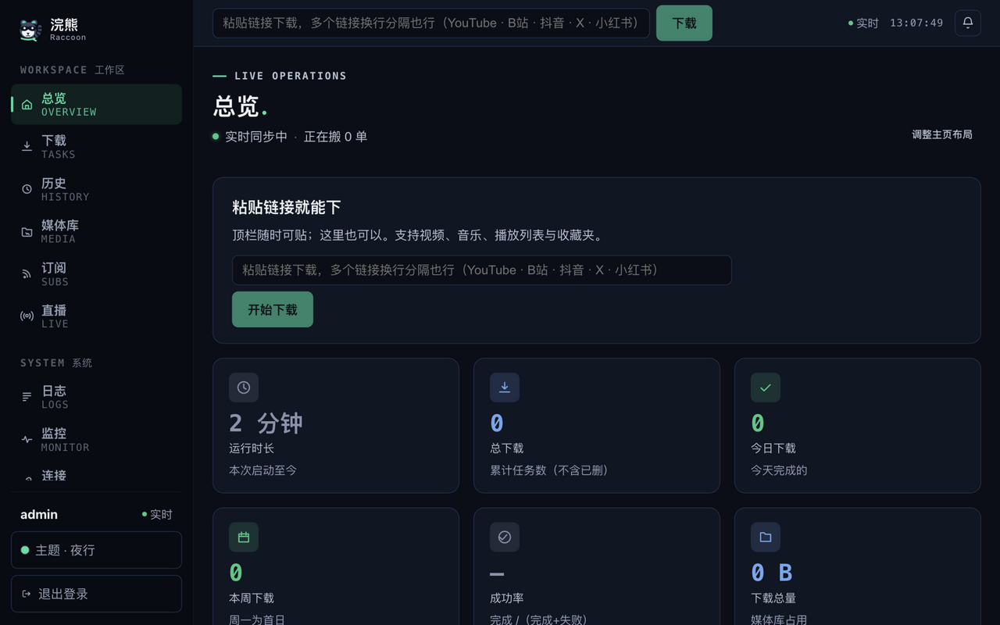
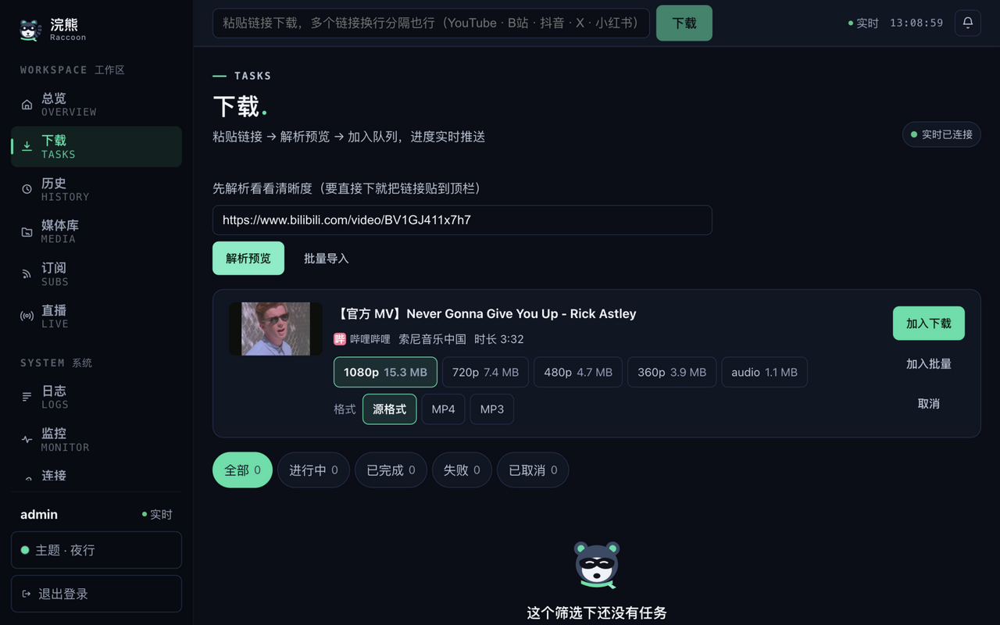
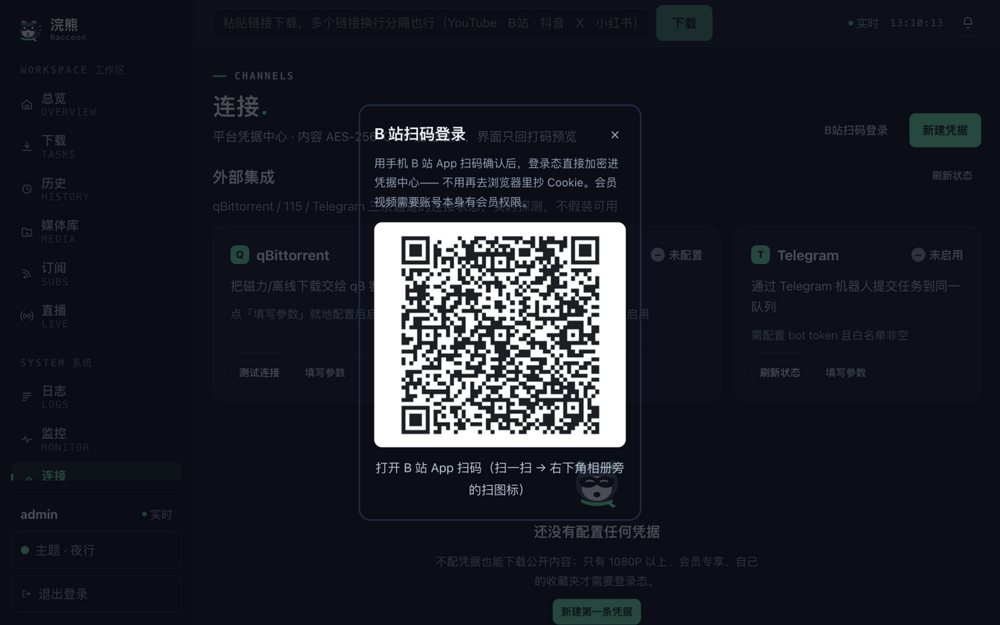
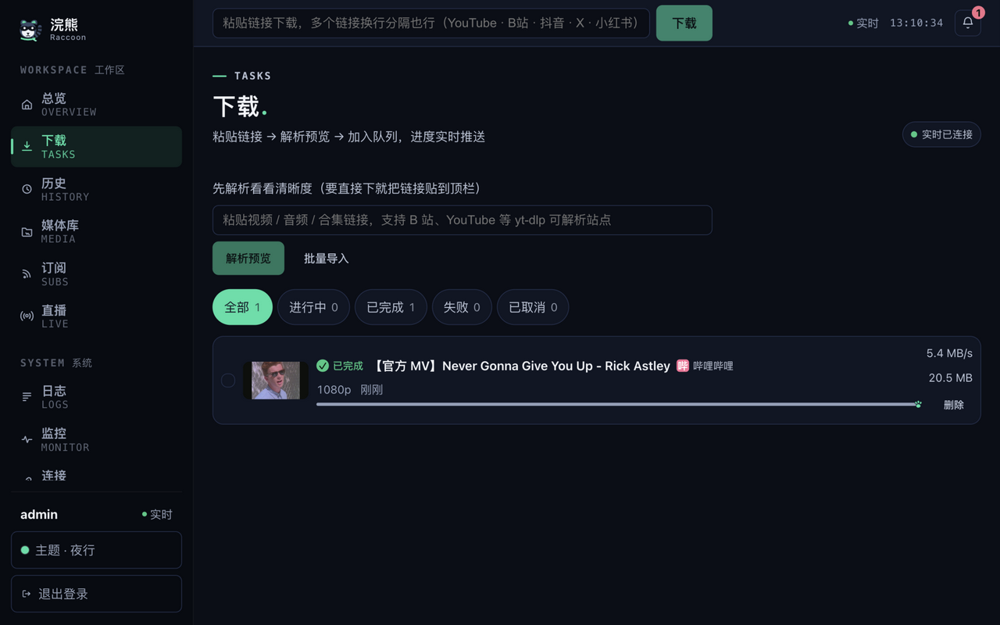
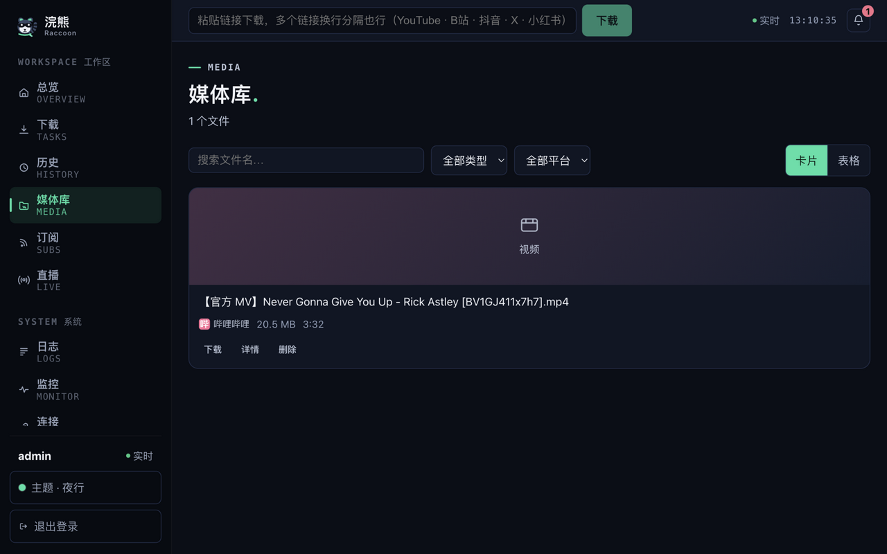
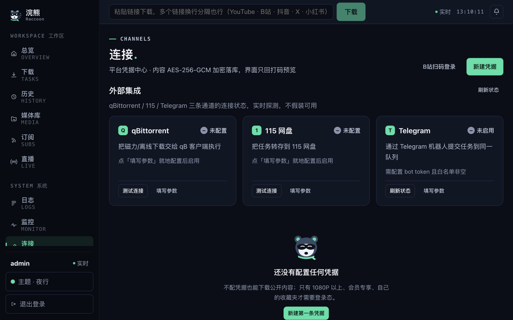
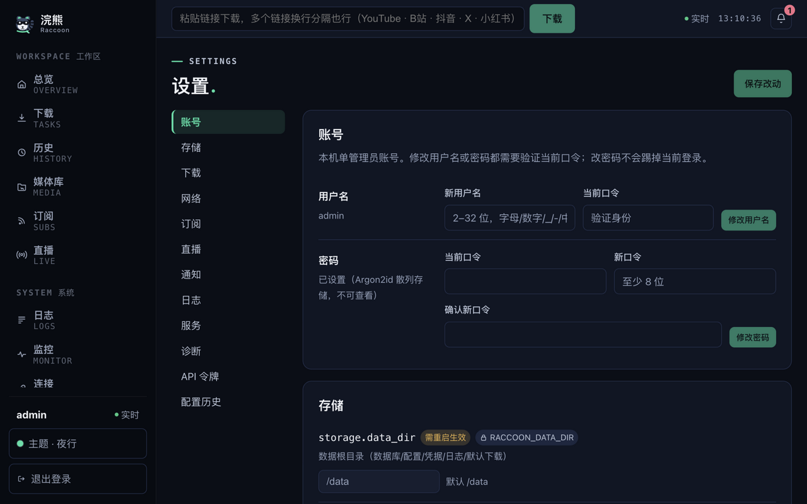

# 🦝 Raccoon（浣熊）· 自托管多媒体下载中心

[](https://github.com/huluohu/Raccoon/actions/workflows/ci.yml)
[](https://hub.docker.com/r/fooololo/raccoon-server)
[](https://hub.docker.com/r/fooololo/raccoon-server)
[](LICENSE)

自托管的一站式下载服务：粘贴链接（B站 / YouTube / 抖音 / X / 小红书等 yt-dlp、gallery-dl 支持的站点），
自动解析 → 入队 → 下载 → 后处理（格式转换 / 封面 / 元数据），Web 界面实时看进度，
Telegram Bot / 微信推送 / iOS 快捷指令 / CLI / MCP 多端触达，全部操作同一个任务队列。

> 设计立场：**能力完整、部署简单、界面好用**。不设付费激活、设备数量限制或功能墙；
> 数据全部落在本机 `/data`，凭据 AES-256-GCM 加密存储，无云端依赖。

## 功能特性

| 模块 | 能力 |
| --- | --- |
| 下载引擎 | yt-dlp（视频/直播回放/播放列表）、gallery-dl（图片/图集）按 URL 形态自动路由 |
| 凭据中心 | 平台 Cookie 加密托管、按任务自动注入；**B 站扫码登录**（手机扫码即用，免手抄 Cookie） |
| 任务系统 | 七态状态机、父子批量任务、失败自动重试（指数退避）、取消/优先级/换通道重试 |
| 后处理 | 任务级**格式转换**（MP4 优先无损 remux，不兼容才 H.264 转码；MP3 音轨提取）、封面图落盘、元数据内嵌（均可配置开关） |
| 外部通道 | qBittorrent 磁力/种子、115 云端离线、直播开播自动录制 |
| 多端入口 | Web / `rc` CLI / MCP（AI 助手）/ Telegram Bot / iOS 快捷指令 / 浏览器扩展 |
| 通知 | 站内通知中心、Webhook、**Server酱微信推送**（任务完成/失败/磁盘预警） |
| 订阅 | UP 主/收藏夹周期检查，新内容自动入队（防重复跨重启） |
| 媒体库 | 入库检索、直链/预览、批量管理 |
| 安全 | 登录 + 双通道鉴权（Cookie 会话 / Bearer Token + scope）、CSRF、SSRF 校验、路径穿越防护、SQL 全参数化、非 root 容器 |

## UI 总览

<p align="center">
  
</p>
总览仪表盘：实时指标、下载趋势、系统健康、进行中任务与失败重试入口一屏尽收。

|  |  |
| --- | --- |
|  **解析预览**：封面/时长/清晰度（带体积）+ 产物格式（源格式 / MP4 / MP3）一步选定 |  **B 站扫码登录**：手机扫码即配好会员下载凭据，免手抄 Cookie |
|  **任务列表**：七态状态机 + SSE 实时进度，失败任务带一键修复建议 |  **媒体库**：下载自动入库，检索 / 预览 / 直链 |
|  **连接页**：凭据中心（AES-256-GCM 加密）与 qB / 115 / Telegram 通道状态 |  **设置中心**：配置项带生效时机，敏感项打码存储 |

## 部署

镜像：`fooololo/raccoon-server`（`1.0.0` 与 `latest`，linux/amd64 + linux/arm64 双架构）。
镜像内已内置 yt-dlp / gallery-dl / FFmpeg / mutagen 等全部引擎，**无需宿主机安装任何依赖**。

部署要素只有四个：

| 要素 | 值 | 说明 |
| --- | --- | --- |
| 端口 | `8530`（容器内）→ 自选宿主端口 | Web 与 API 同口 |
| 数据卷 | `/data` | 数据库/配置/凭据/日志/默认下载，**唯一必需挂载** |
| 环境变量 | `TZ=Asia/Shanghai`（推荐） | 可选：`RACCOON_SERVER_ADDR`、`RACCOON_LOG_LEVEL` |
| 权限 | 容器以 uid `1000` 运行 | 数据目录需允许该用户写入 |

### 方式一：Docker CLI

```bash
# 1. 建数据目录（属主交给 uid 1000，避免权限问题）
mkdir -p /opt/raccoon/data
chown 1000:1000 /opt/raccoon/data

# 2. 起容器
docker run -d \
  --name raccoon \
  --restart unless-stopped \
  -p 8530:8530 \
  -v /opt/raccoon/data:/data \
  -e TZ=Asia/Shanghai \
  fooololo/raccoon-server:1.0.0

# 3. 健康检查（应返回 {"status":true,...}）
curl http://127.0.0.1:8530/healthz
```

升级：`docker stop raccoon && docker rm raccoon` 后用新 tag 重复第 2 步（数据都在挂载目录里）。

### 方式二：Docker Compose（推荐长期使用）

`docker-compose.yml`：

```yaml
services:
  raccoon:
    image: fooololo/raccoon-server:1.0.0   # 升级 = 改这一行
    container_name: raccoon
    restart: unless-stopped
    ports:
      - "8530:8530"
    volumes:
      - ./data:/data          # 数据库/配置/凭据/日志/默认下载（唯一必需挂载）
      # - ./media:/media      # 可选：挂已有媒体库，在设置里把下载目录指到 /media 下
    environment:
      TZ: Asia/Shanghai
```

```bash
docker compose up -d      # 启动
docker compose pull && docker compose up -d   # 升级（先改 image 的 tag）
curl http://127.0.0.1:8530/healthz            # 健康检查
```

备份 = 打包 `./data` 目录（含数据库与凭据主密钥，两者必须一起备份）。

### 方式三：NAS（群晖 / 威联通等）

NAS 部署与上面完全同构——镜像名、端口、挂载、环境变量都一样，只是界面操作路径不同。
通用注意：**容器以 uid 1000 运行，数据目录必须允许该用户写入**；浏览器访问 `http://NAS的IP:8530`。

**群晖 Synology（DSM 7.x，Container Manager）**

1. **File Station** 建目录 `docker/raccoon`，右键 → 属性 → 权限 → 新增用户/用户组（uid 1000 或 `docker`）→ 勾选「可读写」；
2. **Container Manager → 注册表**：搜索 `fooololo/raccoon-server`，选 tag `1.0.0` 下载（ DSM 7.2 也可以直接用「项目 Project」功能贴上面的 compose 文件，后面跳过 3–5 步）；
3. **映像**：选中下载好的镜像 → 运行 → 常规设置容器名 `raccoon`，勾选「开机自动重新启动」；
4. **端口设置**：本地端口填 `8530`（被占可改如 `18530`），容器端口 `8530`，类型 TCP；
5. **存储空间**：添加文件夹 `/docker/raccoon` → 装载路径 `/data`；**环境**：添加 `TZ=Asia/Shanghai`；完成。

**威联通 QNAP（QTS 5.x，Container Station）**

1. **File Station** 建共享文件夹或子目录 `raccoon`，设置权限允许 uid 1000（或 admin）读写；
2. **Container Station → 映像文件**：提取 `fooololo/raccoon-server:1.0.0`（ registry 仓库地址填 `fooololo/raccoon-server`）；
3. 映像列表 → **+ 创建容器**：名称 `raccoon`，重启策略 `always`；
4. **高级设置**：
   - 网络：转发端口 `8530 → 8530`（TCP）；
   - 存储区：主机路径 `<你的目录>` ↔ 容器路径 `/data`；
   - 环境：`TZ=Asia/Shanghai`；
5. 创建后在「容器」页确认运行中，浏览器访问 `http://NAS_IP:8530`。

**其它 NAS / 家庭系统（unRAID、飞牛 fnOS、OpenMediaVault 等）**：
都能跑 Docker——用「方式二」的 compose 文件（unRAID 用 Compose 插件 / Apps 里 Docker Compose Manager；fnOS 的 Docker 管理器直接支持 compose），或按「部署要素」表逐项填入对应 UI 即可。

### 部署后：3 分钟上手

1. 浏览器打开 `http://<主机IP>:8530`，首次访问进入**初始化向导**，创建管理员账号；
2. 粘贴任意视频链接 → 解析预览 → 选清晰度 / 格式（源格式 / MP4 / MP3）→ 加入队列；
3. 需要会员内容：连接页点 **B 站扫码登录**，手机 B 站 App 扫码即用。

公网访问请务必套 HTTPS 反向代理（Nginx 需 `proxy_buffering off` 以支持实时进度流），并使用强口令与最小权限的 API 令牌。

### 能力边界（诚实声明）

- 会员/付费内容需要账号本身的权限：扫码登录解决的是「凭据怎么进来」，不是「绕过付费墙」；
- DRM 加密内容（Netflix、优酷/腾讯/爱奇艺大部分 VIP 剧）任何凭据都无法下载（不破解 DRM）；
- 各平台接口随时可能改版导致解析失败，届时升级镜像内引擎版本即可。

## 使用入口

| 入口 | 一句话 |
| --- | --- |
| Web 界面 | 全功能管理台（实时进度、订阅、直播、媒体库、设置） |
| `rc` CLI | `rc login` 一次，之后 `rc add <url>` 提交、`rc list / status / files` 管理 |
| MCP | `rc mcp` 注册进 Claude 等 MCP 客户端，AI 助手代管下载 |
| Telegram Bot | 设置页填 Bot Token，发链接即入队，进度/完成主动推送 |
| iOS 快捷指令 | Safari 分享 → 一键提交到家里实例（设置页签发 API 令牌） |
| 浏览器扩展 | Chrome/Edge MV3，当前页一键发送（见仓库 `extension/` 目录） |

## 开发

环境要求：Go 1.20+、Node 20+、Docker（构建镜像）。

```bash
make verify          # 一键验证：gofmt / go vet / 后端编译 / 前端 typecheck+build / 设计符合度对账
make backend-test    # 后端全量测试
make web-test        # 前端全量测试
make web-dev         # 前端开发服务器 :5173（/api 代理到 8530）
make docker-build    # 本地构建镜像
make docker-release  # 双架构构建并推 Docker Hub（需 docker login）
```

提交到 main 自动触发 [CI](https://github.com/huluohu/Raccoon/actions/workflows/ci.yml)
（后端 gofmt/vet/测试、前端类型检查/构建/vitest、设计符合度对账、镜像可构建四道门禁）；
**发版**推 `v*` 标签（如 `git tag v1.0.1 && git push --tags`）自动走
[Release 流水线](https://github.com/huluohu/Raccoon/actions/workflows/release.yml)：
测试全绿后双架构构建，同步推 Docker Hub 与 GHCR 并更新 `latest`。

## 目录结构

```
Raccoon/
├── docs/                   # 设计与运维文档（需求契约 / 架构 / API / 部署指南等）
├── extension/              # 浏览器扩展（Chrome/Edge MV3，零依赖）
├── backend/                # Go 服务端
│   ├── cmd/raccoon/        # 服务入口；cmd/rc/ 为 CLI + MCP 服务器
│   └── internal/
│       ├── server/         # HTTP：路由 + 中间件 + SSRF/CSRF 校验
│       ├── task/           # 七态状态机 + 调度 + 凭据桥接
│       ├── engine/         # 引擎集：yt-dlp / gallery-dl + 格式转换
│       ├── bilibili/       # B 站扫码登录（passport 协议客户端）
│       ├── store/          # SQLite 唯一数据出口 + 版本化迁移
│       ├── credential/     # 凭据保管（AES-256-GCM）
│       ├── qb/ n115/ tgbot/ live/   # 外部通道与直播守护
│       └── config/ httpx/ logx/ ...
└── web/                    # Vue 3 + TypeScript 管理界面（pinia / vitest）
```

## 核心约定

- **单一任务系统**：所有入口操作同一队列、同一状态机，没有第二套任务系统；
- **状态即真相**：失败不美化、大小未知不估算、不支持的能力不说「能」；
- **数据单目录**：`/data` 承载数据库、配置、凭据、日志与下载文件，备份恢复只认这一个目录。

## 许可证

[MIT](LICENSE) — 可自由使用、修改、分发与二次开发，仅需保留版权与许可声明。
