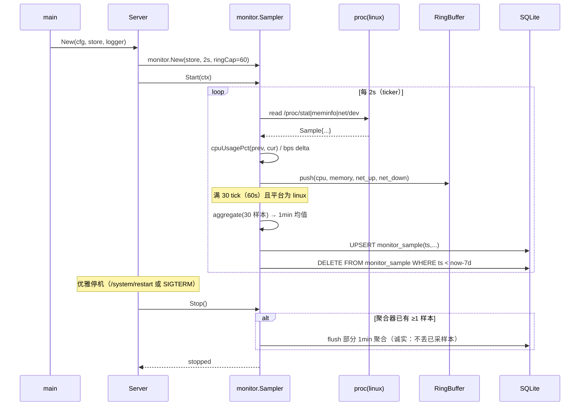
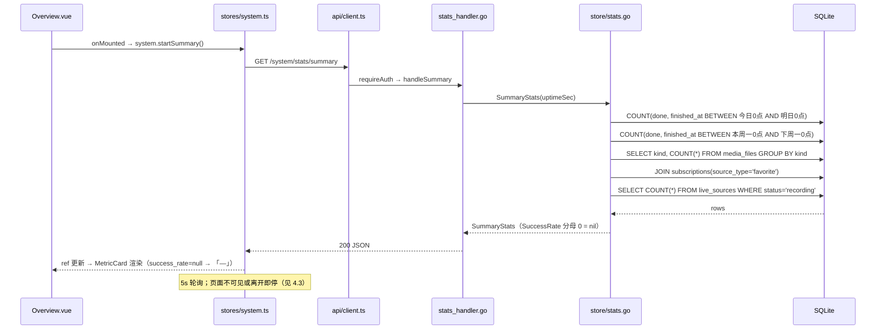
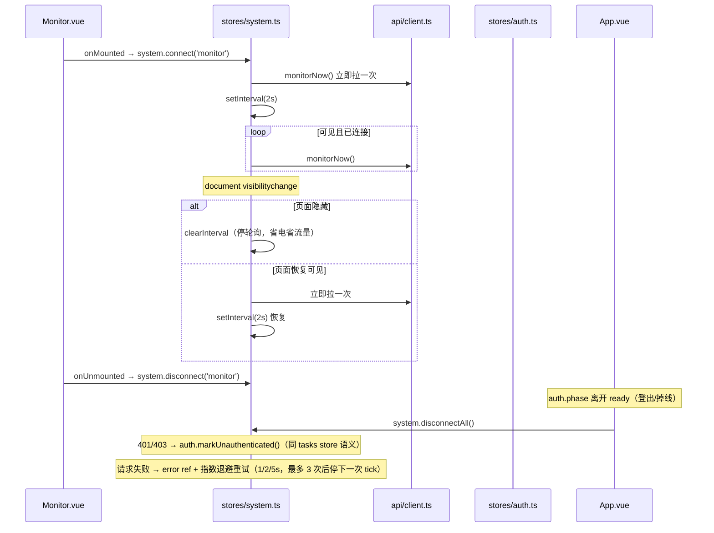
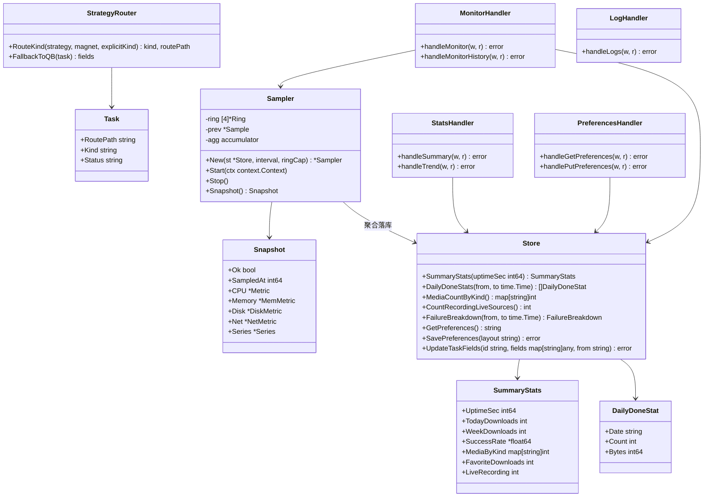
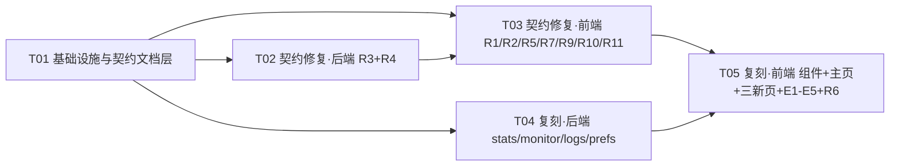

# 15 · 系统性重构 + SaveXTube 复刻 · 增量设计

> 项目：Raccoon（浣熊）· 自托管多媒体下载中心 ｜ 作者：架构师（software-architect-2）
> 输入：docs/13（契约修复波 PRD）、docs/14（SaveXTube 复刻波 PRD）、docs/01–08（设计宪法）
> 代码基线：commit 0cec068（HEAD）｜ 日期：2026-10-23
> 纪律：设计决策给理由；与两份 PRD 不一致处显式说明以哪个为准；本文件是工程师实现的唯一依据。

---

## 1. 实现方案总览

### 1.1 两波次编排

| 波次 | 任务 | 内容 | 出口标准 |
| --- | --- | --- | --- |
| Wave 0 · 地基 | T01 | 迁移（0006/0007）、配置注册表补项、docs/03/04/07/08/10 契约校准、闸门文档级断言 | 四道门禁全绿；docs/04 路由总表与 router 注册零偏差；docs/07 §3/§4/§6 与新 IA 一致 |
| 契约修复波 | T02（后端）+ T03（前端） | R1 删文件入口 / R2 对话框文案 / R3 存储策略路由 / R4 交付记录 / R5 快捷键全局化 / R7 闸门断言 / R9 post 条纹 / R10 暂停说明 / R11 深色封面边框 | 删记录/删文件两个独立操作均有 RDialog 二次确认；六页 `/` 聚焦 + G D/G S 跳转；storage.strategy 三值路由矩阵单测全绿；任务详情显示「走了哪条路」；闸门 228 → 230+ exit 0 |
| 复刻波 | T04（后端）+ T05（前端） | 导航 10 项 + tabbar 5+更多、主页 17 块仪表盘、4+1 个新端点 + preferences 2 端点、MetricCard/TrendChart/DonutChart 纯 SVG、History/Logs/Monitor 三新页、E1–E5 增强、R6 四档截图 | 新端点同日落进 docs/04 §2；三新页 + 六新组件各有 spec；monitor 非 Linux 诚实降级；四档截图 mtime 晚于最后前端提交并附走查记录 |

T02/T03 与 T04 无相互依赖（仅共同依赖 T01），可并行；T05 依赖 T03（App.vue 导航/快捷键同文件）与 T04（API 契约）。

### 1.2 与两份 PRD 的差异裁决记录（以哪个为准）

| # | PRD 原文 | 裁决 | 依据 |
| --- | --- | --- | --- |
| 1 | docs/13 Q1 删除是否连同文件 | **拆两个独立操作**（删记录/删文件），均 RDialog 二次确认；R2 文案改「仅删除任务记录，已下载文件保留在媒体库」 | 主理人裁决 + docs/01 §5.5 |
| 2 | docs/13 Q2 存储策略本轮是否实施 | **本轮实施**（R3），docs/10 §1 的 4.7 行在 T02 完成后更新为已交付并附证据 | 主理人裁决 |
| 3 | docs/13 Q4 post 进度形态 | **R9-b 前端方案**：post 态不确定条纹 + 「后处理中」，后端零改 | 主理人裁决（与解析态条纹一致，零后端风险） |
| 4 | docs/13 Q6 auth/status 方法 | **文档对齐实现**：docs/04 §2.1 改 POST；auth_handler.go 不动 | 主理人裁决；docs/12 已声明外部消费者以 docs/04 为契约，改文档即同步契约 |
| 5 | docs/14 Q1 导航项数 | **10 项**（9 复刻 + Raccoon 自有「连接」）；「媒体库」标签保留（docs/14 Q6 建议改「文件」不采纳，tabbar 用短标签「文件」） | 主理人裁决 |
| 6 | docs/14 Q2 移动端 tabbar | **5 高频（主页/任务/历史/文件/设置）+「更多」面板**；docs/07 §6 同步修订 | 主理人裁决 |
| 7 | docs/14 §2.5 监控历史「内存环形缓冲」 | **1min 聚合落 SQLite（monitor_sample 表），保留 7 天**；API 仍是 ?range=1h\|24h | 主理人裁决（重启后历史不清零、可实现 24h 视图；PRD 内存方案不采纳） |
| 8 | docs/14 Q3 采样频率 | **实时 2s × 60 点内存环**（仅供 /system/monitor 的 series）；**历史 1min 聚合 × 60 点/视图**（1h=60×1min，24h=60×24min） | 主理人裁决 |
| 9 | docs/14 Q4 图表选型 | **纯 SVG，禁引图表库**（四条理由见 docs/14 §3.4，认可） | 主理人裁决 |
| 10 | docs/14 Q5 历史页边界 | **只读**：不给取消/重试/删除按钮 | 主理人裁决 |
| 11 | docs/14 Q7 运行时长副行 | **本次启动**（与 /system/info uptime 同源）+ tooltip「自本次启动以来」 | 主理人裁决 |
| 12 | docs/14 E1 持久化载体 | **user_preferences 表 + GET/PUT /user/preferences**，不借用配置中心 | 架构师决策，理由见 §3.6 |
| 13 | docs/13 Q3 同名撞名带清晰度维度 | **P2，本轮不做**（保存策略缺陷需产品决策命名维度；Raccoon 现状 docs/09 §4 已如实记录） | docs/13 §4 排除项 + 主理人「P2」口径 |
| 14 | docs/13 R8 counts 来源 | **权威来源写为 GET /system/queue**（实现不变，仅修文档） | 架构师决策：Overview 已在用 /system/queue；改 /tasks 响应体会动 tasks store 主链路，收益为零风险不为负 |

### 1.3 新增第三方依赖

**无。** Go 侧全部标准库（net/http、os、strings、sync、time）；前端图表全部手写 SVG。这本身就是设计约束的兑现：docs/01 §1「单静态二进制」+ docs/07 §8 CI 只有 `npm ci && vue-tsc && vite build && vitest run`，引图表库即扩供应链与 embed.FS 体积。

---

## 2. 新增 / 修改文件清单

> 路径相对仓库根。职责一句话；「新建/修改」标明。复用点逐条列明（§2.4）。

### 2.1 后端 · 新建

| 文件 | 职责 | 所属任务 |
| --- | --- | --- |
| backend/internal/store/migrations/0006_monitor_sample.up.sql | monitor_sample 监控历史表（1min 聚合，保留 7 天）+ tasks 表增 route_path 列（R3「走了哪条路」） | T01 |
| backend/internal/store/migrations/0007_user_preferences.up.sql | user_preferences 单行表（E1 仪表盘布局跨设备持久化，单用户假设） | T01 |
| backend/internal/task/strategy.go | R3 存储策略路由：三值判定（local/n115_first/qb_fallback）+ 路由矩阵 + route_path 人类可读链路生成 | T02 |
| backend/internal/task/strategy_test.go | 三值 × 成功/失败转移矩阵单测（含 qB 也不可用 → failed 保留上下文） | T02 |
| backend/internal/monitor/monitor.go | Sampler 生命周期（Start/Stop）、60 点环形缓冲、1min 聚合、Snapshot()；平台无关部分 + fixture 可测解析入口 | T04 |
| backend/internal/monitor/sampler_linux.go | `//go:build linux`：/proc/stat 两次采样差算 CPU、/proc/meminfo 内存、/proc/net/dev 网络差量、磁盘复用 statfs | T04 |
| backend/internal/monitor/sampler_other.go | `//go:build !linux`：采集桩，Snapshot 返回 ok=false + 降级 message（dev macOS 诚实降级，不返假数据） | T04 |
| backend/internal/monitor/monitor_test.go | fixture 文本注入解析器（used_pct/两次采样差/环形淘汰/聚合均值/保留期删除） | T04 |
| backend/internal/store/stats.go | 聚合查询：SummaryStats / DailyDoneStats / MediaCountByKind / CountBySource / CountFavoriteDownloads / CountRecordingLiveSources / FailureBreakdown | T04 |
| backend/internal/store/stats_test.go | 跨日/跨周边界、空窗补 0、时区口径、已删订阅快照口径、success_rate 分母 0 | T04 |
| backend/internal/store/preferences.go | user_preferences 单行读写（UPSERT，CHECK(id=1)） | T04 |
| backend/internal/store/preferences_test.go | 默认值 / 保存 / 覆盖 / 非法 JSON 拒绝 | T04 |
| backend/internal/server/stats_handler.go | GET /system/stats/summary、GET /system/stats/trend（days 校验 400 VALIDATION） | T04 |
| backend/internal/server/monitor_handler.go | GET /system/monitor、GET /system/monitor/history（range 校验；非 Linux ok=false） | T04 |
| backend/internal/server/log_handler.go | GET /logs：按行解析 logx JSON + 过滤 + 行号游标；**复用** system_handler.go 的 readLogTail/redactLine（不造第二套脱敏） | T04 |
| backend/internal/server/preferences_handler.go | GET /PUT /user/preferences（布局 JSON 校验：hidden/order 数组、元素 ≤64 字符、总数 ≤64） | T04 |

### 2.2 后端 · 修改

| 文件 | 改动 | 所属任务 |
| --- | --- | --- |
| backend/internal/config/config.go | Registry 增两项：`storage.strategy`（三值，默认 `local`，NextTask）、`alert.success_rate_threshold`（默认 80，Immediate）——五要素齐全，env 锁定行为随框架 | T01 |
| backend/internal/task/manager.go | Submit 按 storage.strategy 判定 kind（磁力/种子类任务）+ route_path 初值落库 | T02 |
| backend/internal/task/worker.go | n115 失败按策略 failover：策略=n115_first 且确定失败 → kind 改写 qb + status 回 waiting + route_path 追补 + AppendEvent；qB 也不可用 → failed 保留上下文 | T02 |
| backend/internal/task/external.go | n115 提交结果分类：确定失败（可转移）vs 不确定（先查询，docs/01 §3.4 提交-查询闭环，不重复下载） | T02 |
| backend/internal/store/model.go | Task 增 `RoutePath string \`json:"route_path,omitempty"\`` | T02 |
| backend/internal/store/tasks.go | insert/scan/UpdateTaskFields 增加 route_path 列 | T02 |
| backend/internal/server/server.go | New 接入 monitor.Sampler（Start(ctx)）+ setupStats/setupMonitor/setupLogs/setupPreferences 路由注册；ShutdownMonitor（flush 未满 1min 的部分聚合） | T04 |

### 2.3 前端

| 文件 | 职责/改动 | 新建/修改 | 所属任务 |
| --- | --- | --- | --- |
| web/src/api/client.ts | 新增 deleteTaskFile、statsSummary、statsTrend、monitorNow、monitorHistory、queryLogs、getPreferences、savePreferences 封装 | 修改 | T03/T04/T05 |
| web/src/api/types.ts | Task 增 route_path；新增 StatsSummary / StatsTrend / TrendPoint / MonitorSnapshot / MonitorHistory / LogItem / LogPage / Preferences 类型（与后端 JSON 同字段名） | 修改 | T03/T05 |
| web/src/composables/useGlobalShortcuts.ts | App 级全局键：`/` 聚焦 #quick-submit、G D/G S 跳转（R5；从 useShortcuts 拆出，避免双注册抢焦点） | 新建 | T03 |
| web/src/composables/useShortcuts.ts | 移除 `/` 与 G 和弦（已上移全局），保留 ↑↓/Enter/Shift+Space/R/Esc 行操作键 | 修改 | T03 |
| web/src/App.vue | 挂载 useGlobalShortcuts；NAV_ITEMS 扩到 10 项（label + tabbar 短标签 short）；tabbar 改 5 高频 + 「更多」面板 | 修改 | T03/T05 |
| web/src/router/index.ts | 增 /history、/logs、/monitor 三条路由与 meta.title | 修改 | T05 |
| web/src/components/media/DeleteFileDialog.vue | 删文件二次确认对话框（RDialog 封装：文件名+大小+完整路径+「只删这个文件，任务记录保留」）；Media.vue 与 Tasks.vue 共用 | 新建 | T03 |
| web/src/components/media/DeleteFileDialog.spec.ts | 打开/确认/取消三路径 + 取消不发请求 | 新建 | T03 |
| web/src/components/media/FileCard.vue | 操作区增「删除文件」按钮（emit delete）；R11 深色缩略图 1px 边框 | 修改 | T03 |
| web/src/views/Media.vue | R1 删文件入口：DeleteFileDialog + 删除后列表/计数刷新 + Toast | 修改 | T03 |
| web/src/components/task/TaskDetail.vue | 概览区增「走了哪条路」行（route_path）；产物区每文件增删除入口（emit delete-file）；操作区增 R10 暂停说明句 | 修改 | T03 |
| web/src/views/Tasks.vue | R2 两处删除文案去掉「及其本地文件」；详情产物删除接线（DeleteFileDialog 复用） | 修改 | T03 |
| web/src/components/task/TaskProgress.vue | R9：stage=post 时不确定条纹 + 「后处理中」 | 修改 | T03 |
| web/src/components/task/TaskCard.vue / TaskRow.vue | R11 深色边框；新增 readonly prop（History 复用时隐去行操作） | 修改 | T03/T05 |
| web/src/components/task/TaskList.vue | 新增 readonly prop（隐去批量工具条、行操作仅详情）——History 只读复用点 | 修改 | T05 |
| web/src/components/media/PreviewDrawer.vue | R11 深色 img/video 1px 边框 | 修改 | T03 |
| web/src/App.spec.ts | R5 验收：六页 `/` → activeElement.id==='quick-submit'；六页 G D/G S 跳转 | 新建 | T03 |
| web/src/stores/system.ts | stats/monitor/logs/preferences 轮询 store：connect/disconnect + visibilitychange 停复轮询（对齐 stores/tasks.ts 模式） | 新建 | T05 |
| web/src/components/base/MetricCard.vue | 指标卡：语义色图标块（color-mix 16%）+ --font-display 大数字（tabular-nums）+ 标签 + 可选副行/跳转 + tone 按值切换 | 新建 | T05 |
| web/src/components/base/MetricCard.spec.ts | 渲染 + tone 切换 + tabular-nums 类名断言 | 新建 | T05 |
| web/src/components/charts/TrendChart.vue | 纯 SVG 折线（viewBox + polyline + 末端圆点 + 单色 12% 面积填充；sparkline 无轴模式） | 新建 | T05 |
| web/src/components/charts/TrendChart.spec.ts | points 属性断言 + 空数据降级「暂无数据」 | 新建 | T05 |
| web/src/components/charts/DonutChart.vue | 纯 SVG 环形图（circle + stroke-dasharray/dashoffset + round 端点 + 图例 + 中心大数字） | 新建 | T05 |
| web/src/components/charts/DonutChart.spec.ts | dasharray 比例 + 空数据降级 | 新建 | T05 |
| web/src/utils/dashboardCards.ts | 17 块卡片注册表：key/label/tone/图标 path/取值来源/格式化（E1 排序与显隐的权威清单） | 新建 | T05 |
| web/src/views/Overview.vue | 主页重构：快速下载引导卡 + 指标行 ×3（12 卡）+ 直播录制卡 + ActiveTasks/StatusStrip 保留 + 监控摘要带（P1）+ 趋势 Tab + E1 自定义面板 + E2 预警接线 | 修改 | T05 |
| web/src/views/History.vue | 历史只读页：TaskList(readonly) 复用 + 日期范围筛选 + 顶部汇总条（前端聚合 + 截断诚实提示） | 新建 | T05 |
| web/src/views/History.spec.ts | 只读（无操作按钮）+ 日期筛选 + 空态 REmpty | 新建 | T05 |
| web/src/views/Logs.vue | 日志页：级别 chips + module 下拉 + 关键词 + 时间范围 + cursor 分页 + E4 实时跟随（3s，默认关） | 新建 | T05 |
| web/src/views/Logs.spec.ts | 过滤器 + 分页 + 脱敏行原样展示（前端不还原） | 新建 | T05 |
| web/src/views/Monitor.vue | 监控页：CPU/内存/存储 donut + 带宽双数字+sparkline + 60 点实时序列 + E3 历史 Tab（1h/24h）；非 Linux 整页 REmpty 降级 | 新建 | T05 |
| web/src/views/Monitor.spec.ts | 2s 轮询生命周期 + 非 Linux 降级 + 历史 Tab | 新建 | T05 |
| web/src/components/overview/IssuesPanel.vue | E2：成功率低于阈值时浮出预警条目（点击跳 /monitor） | 修改 | T05 |

### 2.4 文档与脚本

| 文件 | 改动 | 所属任务 |
| --- | --- | --- |
| docs/04-API详细设计.md | §2.1 auth/status 改 POST；§2.2 补 POST /tasks/parent、counts 来源声明；§2.9 补 GET /system/queue；新增 §2.10 统计/监控/日志（5 端点详细契约）、§2.11 API Token（tokens ×3）、§2.12 外部集成（integrations ×4）、§2.13 user preferences（2 端点） | T01 |
| docs/07-前端设计落地.md | §3 路由表 10 条 + 标签；§4 组件清单补 MetricCard/TrendChart/DonutChart/DeleteFileDialog/History/Logs/Monitor；§6 tabbar 5+更多；R12 `--surface-2:#EEEF2` → `#EEF0F7` | T01 |
| docs/03-数据模型设计.md | 同步 monitor_sample / user_preferences / tasks.route_path（迁移同源） | T01 |
| docs/10-Wave4-5交付与验收.md | R4：§1 的 4.7 行更新为已交付 + 证据指向（T02 落地后执行） | T02 |
| docs/08-开发计划.md | §8 进度状态追加本轮两波次口径 | T01 |
| scripts/check-design-conformance.py | 文档级断言（docs/04 含 7 新端点、docs/07 §4 含 6 新组件）随 T01 落地；代码级断言（App.vue 引用 useGlobalShortcuts、client.ts deleteTaskFile 被 Media/TaskDetail 引用、深色边框、新路由注册、新组件配 spec）随 T03/T05 落地——**闸门每个任务后必须 exit 0，断言不超前于被断言代码** | T01/T03/T05 |

---

## 3. 数据结构与接口

### 3.1 新端点契约（docs/04 格式；全部 /api/v1 下、requireAuth 会话认证）

#### §2.10-a GET /system/stats/summary —— 主页指标聚合

| 项 | 内容 |
| --- | --- |
| 入参 | 无 |
| 出参 | `{"uptime_sec":32400,"total_downloads":2,"today_downloads":2,"week_downloads":2,"success_rate":100.0,"media_bytes":232883456,"media_by_kind":{"video":2,"audio":0,"image":0,"subtitle":0,"other":0},"sub_downloads":0,"favorite_downloads":0,"live_recording":0}` |
| 口径 | today/week = status='done' 且 finished_at 落在**服务端本地时区**自然日/自然周（周一为首日）；success_rate = done/(done+failed)，**分母为 0 时返回 null**（前端显示「—」，不显示 0%/100% 造假）；uptime_sec = 本次启动（与 /system/info 同源）；favorite_downloads = tasks.source='subscription' 且关联 subscriptions.source_type='favorite' 的 done 数（**快照口径**：订阅删除后历史任务仍计入）；live_recording = live_sources.status='recording' 计数 |
| 错误 | 500 INTERNAL（聚合失败） |

#### §2.10-b GET /system/stats/trend?days=7

| 项 | 内容 |
| --- | --- |
| 入参 | days ∈ {7,30}，默认 7；其他值 400 VALIDATION |
| 出参 | `{"days":7,"points":[{"date":"2026-10-17","count":2,"bytes":232883456}, ...]}`——按日升序，无数据日补 0，**长度恒等于 days**；末元素为本地时区今日 |
| E5 扩展（P2） | 出参附 `"failures":{"by_platform":[{"key":"yt-dlp","count":3}],"by_reason":[{"key":"COOKIE_EXPIRED","count":2}]}`（同一时间窗内 failed 任务按 platform/error_code 聚合，降序，各上限 10） |
| 错误 | 400 VALIDATION（days 非法） |

#### §2.10-c GET /system/monitor —— 实时监控

| 项 | 内容 |
| --- | --- |
| 入参 | 无 |
| 出参（Linux） | `{"ok":true,"sampled_at":1730000000,"cpu":{"used_pct":0.0},"memory":{"used_pct":10.5,"used_bytes":788000000,"free_bytes":6900000000,"total_bytes":7700000000},"disk":{"used_pct":97.4,"free_bytes":12700000000,"total_bytes":128800000000},"net":{"up_bps":0,"down_bps":0},"series":{"cpu":[60点],"memory":[60],"net_up":[60],"net_down":[60]}}`——series 点值 number\|null（null=该时刻采集失败，前端断线渲染，不插值造假）；窗口 2s×60=2 分钟 |
| 出参（非 Linux） | `{"ok":false,"message":"当前平台不支持资源监控（仅 Linux 采集 /proc）"}` |
| 错误 | 500 INTERNAL |

#### §2.10-d GET /system/monitor/history?range=24h

| 项 | 内容 |
| --- | --- |
| 入参 | range ∈ {1h,24h}，其他 400 VALIDATION |
| 出参 | `{"range":"24h","granularity_sec":1440,"points":[{"ts":1730000000,"cpu":12.5,"memory":10.5,"disk":97.4,"net_up":0,"net_down":0}, ...]}`——1h=60 点×60s（1min 聚合原值），24h=60 点×1440s（24min 均值）；数据来自 monitor_sample 表；非 Linux `{"ok":false,...}` 同 §2.10-c |
| 界面约束 | 非 Linux 平台 Monitor.vue 隐藏历史 Tab（不显示不可用入口，诚实原则） |

#### §2.10-e GET /logs

| 项 | 内容 |
| --- | --- |
| 入参 | level（debug/info/warn/error，逗号多选，默认 info,warn,error）、module、q（≤256 字符，超长**截断**不报错）、from/to（Unix 秒）、limit（默认 100 上限 500）、cursor（行号游标，空=从文件头） |
| 出参 | `{"items":[{"ts":1730000000,"level":"info","module":"task","msg":"..."}],"next_cursor":"1200"}`——按 ts 升序（实时跟随语义）；next_cursor 为下一段起始行号，无更多时返回当前 cursor |
| 脱敏 | **复用** redactLine（cookie/token/password/key → ***）；含 token 明文的日志行，接口输出必为 ***（安全用例固化） |
| 错误 | 400 VALIDATION（level 值非法/limit 超限） |

#### §2.13 user preferences（E1）

| 方法 | 路径 | 出参 |
| --- | --- | --- |
| GET | /user/preferences | `{"data":{"layout":"{\"hidden\":[],\"order\":[]}"}}`——layout 为 JSON 字符串：hidden=隐藏的卡片 key 数组，order=排序后的卡片 key 数组（缺省 key 按注册表默认顺序追加） |
| PUT | /user/preferences | body `{"layout":"..."}` → 校验（合法 JSON 对象、hidden/order 为字符串数组、元素 ≤64 字符、两数组各 ≤64）→ `{"data":{"layout":"..."}}`；非法 400 VALIDATION |

### 3.2 迁移 DDL（只增不改）

`backend/internal/store/migrations/0006_monitor_sample.up.sql`：

```sql
-- 0006：监控历史聚合（monitor_sample）+ 任务存储路径留痕（tasks.route_path）。
-- monitor_sample：1min 聚合一行，保留 7 天（sampler 每次聚合写入口删除过期行）。
-- route_path：R3 存储策略「走了哪条路」的人类可读链路，如
--   "本地下载" / "qB" / "115 优先 → 115 提交成功" / "115 失败 → 转 qB"。
CREATE TABLE IF NOT EXISTS monitor_sample (
    ts      INTEGER PRIMARY KEY,          -- Unix 秒，聚合桶起点
    cpu     REAL NOT NULL,
    memory  REAL NOT NULL,
    disk    REAL NOT NULL,
    net_rx  REAL NOT NULL,
    net_tx  REAL NOT NULL
);
ALTER TABLE tasks ADD COLUMN route_path TEXT NOT NULL DEFAULT '';
```

`backend/internal/store/migrations/0007_user_preferences.up.sql`：

```sql
-- 0007：用户偏好单行表（E1 仪表盘布局；docs/14 §5.6 单用户假设，CHECK 兜底）。
CREATE TABLE IF NOT EXISTS user_preferences (
    id         INTEGER PRIMARY KEY CHECK (id = 1),
    layout     TEXT NOT NULL DEFAULT '{"hidden":[],"order":[]}',
    updated_at INTEGER NOT NULL
);
```

### 3.3 store/stats.go 查询签名

```go
// SummaryStats 主页指标聚合（docs/14 §2.1 口径）。
type SummaryStats struct {
    UptimeSec        int64          `json:"uptime_sec"`
    TotalDownloads   int            `json:"total_downloads"`   // 全部非软删任务数
    TodayDownloads   int            `json:"today_downloads"`   // done 且 finished_at ∈ 本地今日
    WeekDownloads    int            `json:"week_downloads"`    // done 且 finished_at ∈ 本地本周（周一起）
    SuccessRate      *float64       `json:"success_rate"`      // done/(done+failed)；分母 0 = nil
    MediaBytes       int64          `json:"media_bytes"`
    MediaByKind      map[string]int `json:"media_by_kind"`     // video/audio/image/subtitle/other
    SubDownloads     int            `json:"sub_downloads"`     // source='subscription' 的 done
    FavoriteDownloads int           `json:"favorite_downloads"`// JOIN subscriptions.source_type='favorite'
    LiveRecording    int            `json:"live_recording"`    // live_sources.status='recording'
}

// DailyDoneStat 趋势单点（date = 本地时区 YYYY-MM-DD）。
type DailyDoneStat struct {
    Date  string `json:"date"`
    Count int    `json:"count"`
    Bytes int64  `json:"bytes"`
}

// FailureBreakdown E5：时间窗内 failed 按平台/原因聚合。
type FailureBreakdown struct {
    ByPlatform []NamedCount `json:"by_platform"`
    ByReason   []NamedCount `json:"by_reason"`
}
type NamedCount struct {
    Key   string `json:"key"`
    Count int    `json:"count"`
}

func (s *Store) SummaryStats(uptimeSec int64) (SummaryStats, error)
func (s *Store) DailyDoneStats(from, to time.Time) ([]DailyDoneStat, error) // 调用方补零
func (s *Store) MediaCountByKind() (map[string]int, error)
func (s *Store) CountRecordingLiveSources() (int, error)
func (s *Store) FailureBreakdown(from, to time.Time) (FailureBreakdown, error)
```

**日期口径（硬约定）**：自然日/周边界在 Go 侧用 `time.Local` 计算（`time.Now().In(time.Local)` 取当日 00:00 与下周一 00:00 的 UnixMilli），SQL 只做 `finished_at BETWEEN ? AND ?` 比较。不写 SQLite `date(...)` 函数——避免 SQLite 时区修饰符与进程时区不一致的坑，且边界可在单测中精确构造。本地时区即容器/进程时区（与 SQLite 'localtime' 同源）。

### 3.4 monitor 包接口

```go
package monitor

// Sample 一次原始采样（linux 实现填充；delta 由 Sampler 计算）。
type Sample struct {
    CPUTotalJiffies, CPUIdleJiffies uint64
    MemUsedBytes, MemTotalBytes     uint64
    DiskUsedPct                     float64
    DiskFreeBytes, DiskTotalBytes   uint64
    NetRxBytes, NetTxBytes          uint64
    Ts                              int64 // Unix 秒
}

// Point 环形缓冲中的一个派生点（percent 或 bps）。
type Point struct {
    Ts    int64    `json:"ts"`
    Value float64  `json:"value"`
}

// Snapshot /system/monitor 的读模型（handler 直接序列化）。
type Snapshot struct {
    Ok        bool       `json:"ok"`
    Message   string     `json:"message,omitempty"`
    SampledAt int64      `json:"sampled_at"`
    CPU       *Metric    `json:"cpu,omitempty"`
    Memory    *MemMetric `json:"memory,omitempty"`
    Disk      *DiskMetric `json:"disk,omitempty"`
    Net       *NetMetric  `json:"net,omitempty"`
    Series    *Series    `json:"series,omitempty"`
}

// Sampler 后台采样器：2s tick、60 点内存环、每 30 tick（60s）聚合落 SQLite。
type Sampler struct { /* mu, ring[4]*Ring, prev *Sample, agg accumulator, st *store.Store, ... */ }
func New(st *store.Store, interval time.Duration, ringCap int) *Sampler
func (m *Sampler) Start(ctx context.Context)      // goroutine ticker
func (m *Sampler) Stop()                          // 取消 + flush 未满 1min 的部分聚合（≥1 样本才落）
func (m *Sampler) Snapshot() Snapshot             // 加锁拷贝环，不在锁内序列化
// fixture 可测的纯函数（linux 实现内，测试注入文本）：
func parseMeminfo(content string) (used, total uint64, err error)
func parseCPUStat(content string) (total, idle uint64, err error)
func parseNetDev(content string) (rx, tx uint64, err error)
func cpuUsagePct(prevTotal, prevIdle, curTotal, curIdle uint64) float64
```

### 3.5 前端 api/client.ts 新增封装 + types.ts 新类型

```ts
// client.ts（追加到 api 对象）
deleteTaskFile: (taskId: string, fileId: string) =>
  request<{ ok: boolean }>(`/tasks/${taskId}/files/${fileId}`, { method: 'DELETE' }),
statsSummary: () => request<StatsSummary>('/system/stats/summary'),
statsTrend: (days: 7 | 30) => request<StatsTrend>(`/system/stats/trend?days=${days}`),
monitorNow: () => request<MonitorSnapshot>('/system/monitor'),
monitorHistory: (range: '1h' | '24h') => request<MonitorHistory>(`/system/monitor/history?range=${range}`),
queryLogs: (params: { level?: string; module?: string; q?: string; from?: number; to?: number; limit?: number; cursor?: string } = {}) => {
  const qs = new URLSearchParams(
    Object.entries(params)
      .filter(([, v]) => v !== undefined && v !== '')
      .map(([k, v]) => [k, String(v)]),
  ).toString()
  return request<LogPage>('/logs' + (qs ? '?' + qs : ''))
},
getPreferences: () => request<{ data: { layout: string } }>('/user/preferences'),
savePreferences: (layout: string) =>
  request<{ data: { layout: string } }>('/user/preferences', { method: 'PUT', body: JSON.stringify({ layout }) }),
```

```ts
// types.ts（新增；字段与后端 JSON 同名，snake_case，禁发明字段）
export interface StatsSummary {
  uptime_sec: number
  total_downloads: number
  today_downloads: number
  week_downloads: number
  success_rate: number | null   // null = 分母 0，显示「—」
  media_bytes: number
  media_by_kind: Record<'video' | 'audio' | 'image' | 'subtitle' | 'other', number>
  sub_downloads: number
  favorite_downloads: number
  live_recording: number
}
export interface TrendPoint { date: string; count: number; bytes: number }
export interface StatsTrend {
  days: number
  points: TrendPoint[]
  failures?: { by_platform: { key: string; count: number }[]; by_reason: { key: string; count: number }[] }
}
export interface MonitorMetric { used_pct: number }
export interface MonitorMemMetric { used_pct: number; used_bytes: number; free_bytes: number; total_bytes: number }
export interface MonitorDiskMetric { used_pct: number; free_bytes: number; total_bytes: number }
export interface MonitorNetMetric { up_bps: number; down_bps: number }
export interface MonitorSnapshot {
  ok: boolean
  message?: string
  sampled_at: number
  cpu?: MonitorMetric
  memory?: MonitorMemMetric
  disk?: MonitorDiskMetric
  net?: MonitorNetMetric
  series?: { cpu: (number | null)[]; memory: (number | null)[]; net_up: (number | null)[]; net_down: (number | null)[] }
}
export interface MonitorHistoryPoint { ts: number; cpu: number; memory: number; disk: number; net_up: number; net_down: number }
export interface MonitorHistory {
  ok?: boolean
  message?: string
  range: string
  granularity_sec: number
  points: MonitorHistoryPoint[]
}
export interface LogItem { ts: number; level: string; module: string; msg: string }
export interface LogPage { items: LogItem[]; next_cursor: string }
export interface DashboardLayout { hidden: string[]; order: string[] }
// Task 接口增：route_path?: string
```

### 3.6 E1 为什么不借用配置中心（架构师决策 + 理由）

docs/14 E1 给的两个选项（user_preferences 表 / 配置表加 JSON 字段）中选前者：

1. **配置中心是「行为设置」注册表**，五要素（key/desc/default/effective/sensitive）是评审门禁；仪表盘布局没有「生效时机」语义（它不是 next_task/immediate/restart 任何一种），混入 registry 会破坏配置中心的类型纯度。
2. **JSON 值在设置页无法友好编辑**：SettingItem 按单值渲染，`{"hidden":[],"order":[]}` 直接暴露给用户是噪音；E1 的主交互是主页 RDialog 拖拽编辑器，设置页出现同一状态的两个编辑入口反而容易不一致。
3. **单用户假设下单表足够**：CHECK(id=1) 兜底，未来多用户时加 user_id 列即可（只增迁移）。

### 3.7 R3 存储策略语义（架构师定本，PRD 未锁死的部分）

三值与路由矩阵（仅对**磁力/种子/离线类任务**生效——Submit 时 kind=KindQB 或显式 KindN115 的；普通直链任务永远本地下载，不受策略影响）：

| 策略值 | Submit 时路由 | 运行期转移 | route_path 示例 |
| --- | --- | --- | --- |
| `local`（默认） | 现状：magnet → qB；n115 仅显式指定 | 无 | 「本地下载」/「qB」 |
| `n115_first` | magnet/种子 → 115 离线提交 | 115 **确定失败**（未配置 token/提交被拒）→ 自动转 qB；115 **结果不确定** → 先查询（提交-查询闭环），不转移；qB 也不可用 → 任务 failed，事件保留完整链路 | 「115 优先 → 115 提交成功」/「115 失败 → 转 qB」/「115 失败 → 转 qB → qB 不可用」 |
| `qb_fallback` | magnet/种子 → 直接 qB（跳过 115 尝试） | 无 | 「qB」 |

failover 机制：worker 在 n115 路径确认失败且策略=n115_first 时，`UpdateTaskFields(id, {kind:"qb", status:"waiting", route_path:追加})` 把任务改写回队列由调度循环重新领取（kind 改写安全的前提：n115 侧未产生任何远程副作用——确定失败才转移；结果不确定先查询）。attempt 不递增（这是路由转移不是重试）。默认值取 `local`：存量用户升级后行为零变化，策略显式可选。

---

## 4. 程序调用流程

### 4.1 monitor sampler 生命周期（启动 / tick / 环形缓冲 / 聚合落库 / 停止）



非 Linux：sampler_other.go 的 sample() 返回 errUnsupported，环保持空，聚合不落库；handler 读 Snapshot() 得 ok=false + message。dev macOS 与生产 Linux 走同一契约，零假数据。

### 4.2 stats 查询链路（summary / trend）



### 4.3 前端轮询生命周期（visibilitychange 停轮询，对齐 stores/tasks.ts connect/disconnect）



轮询参数表（前端唯一权威）：summary 5s、trend 60s、monitor 2s、logs 按需（E4 跟随 3s）、monitor/history 仅 Tab 激活时拉一次。所有定时器在 disconnect/隐藏时清理，杜绝「离开页面还在轮询」的隐藏泄漏（docs/13 I1 类盲区的前置防御）。

---

## 5. 任务列表（按实现顺序；粒度 = 工程师一个 turn 完成一批相关文件）

> 纪律：每个任务完成后四道门禁必须全绿（check-design-conformance exit 0、npm run build、vitest run、go build+vet+test）；**不允许把闸门留在红色进入下一任务**。T02/T03 与 T04 可并行（互不依赖），T05 收口。

### T01 · 基础设施与契约文档层（Wave 0）

- **涉及文件**：backend/internal/store/migrations/0006_monitor_sample.up.sql（新建）、backend/internal/store/migrations/0007_user_preferences.up.sql（新建）、backend/internal/config/config.go（+storage.strategy、+alert.success_rate_threshold）、docs/04-API详细设计.md、docs/07-前端设计落地.md、docs/03-数据模型设计.md、docs/08-开发计划.md、scripts/check-design-conformance.py（文档级断言）
- **依赖**：无
- **优先级**：P0
- **可观测验收**：
  1. `cd backend && /usr/local/go/bin/go test -count=1 ./internal/store/...` 绿（迁移 runner 应用 0006/0007 成功，checksum 记录更新）；
  2. `GET /config` 返回含 `storage.strategy`（默认 "local"）与 `alert.success_rate_threshold`（默认 80）且五要素齐全（config 单测断言）；
  3. docs/04 §2 与 router 注册逐条核对零偏差（附核对记录：方法+路径+认证+用途四列），含 auth/status=POST、tasks/parent、system/queue、tokens×3、integrations×4、7 个新端点；
  4. docs/07 §3 十条路由、§4 六个新组件、§6 tabbar「5+更多」、`--surface-2:#EEF0F7` 修订完成；全仓 grep 无 `#EEEF2`；
  5. `python3 scripts/check-design-conformance.py` exit 0（总数 228+文档级新增，代码级断言留到 T03/T05 随代码落地）。

### T02 · 契约修复波 · 后端：R3 存储策略路由 + R4 交付记录

- **涉及文件**：backend/internal/task/strategy.go（新建）、backend/internal/task/strategy_test.go（新建）、backend/internal/task/manager.go、backend/internal/task/worker.go、backend/internal/task/external.go、backend/internal/store/model.go、backend/internal/store/tasks.go、docs/10-Wave4-5交付与验收.md
- **依赖**：T01
- **优先级**：P0
- **可观测验收**：
  1. strategy_test.go 覆盖三值 × {115 成功 / 115 确定失败 / 115 结果不确定 / qB 也不可用} 矩阵，全绿；
  2. `GET /config` 中 storage.strategy 可改（PUT /config 200，env 锁定行为与其他项一致）；
  3. 任务详情 JSON 含 `route_path` 字段，文案与实际执行路径一致（integration/单测断言）；
  4. n115_first 下 115 确定失败的任务自动转 qB 且 attempt 不递增（单测）；结果不确定时先查询不转移（单测）；
  5. docs/10 §1 的 4.7 行更新为「✅ 已交付（策略路由，验收：strategy_test.go 矩阵 + route_path 留痕）」，无模糊表述；
  6. go build/vet/test 全绿。

### T03 · 契约修复波 · 前端：R1 删文件 / R2 文案 / R5 快捷键全局化 / R7 断言 / R9 post 条纹 / R10 暂停说明 / R11 深色边框

- **涉及文件**：web/src/api/client.ts（+deleteTaskFile）、web/src/api/types.ts（+route_path）、web/src/composables/useGlobalShortcuts.ts（新建）、web/src/composables/useShortcuts.ts、web/src/App.vue（挂载全局快捷键）、web/src/App.spec.ts（新建）、web/src/components/media/DeleteFileDialog.vue + .spec.ts（新建）、web/src/components/media/FileCard.vue + .spec.ts、web/src/views/Media.vue + .spec.ts、web/src/components/task/TaskDetail.vue + .spec.ts、web/src/views/Tasks.vue + .spec.ts、web/src/components/task/TaskProgress.vue + .spec.ts（新建）、web/src/components/task/TaskCard.vue、web/src/components/task/TaskRow.vue、web/src/components/media/PreviewDrawer.vue、scripts/check-design-conformance.py（代码级断言）
- **依赖**：T01、T02（TaskDetail 展示 route_path；其余前端项不依赖后端）
- **优先级**：P0
- **可观测验收**：
  1. R1：媒体库文件卡与任务详情产物区均有「删除文件」；点击弹 RDialog（默认焦点「取消」）展示文件名+大小+完整路径+「只删这个文件，任务记录保留」；确认后列表/计数即时刷新；取消零请求（DeleteFileDialog.spec 三路径 + Media.spec/ TaskDetail.spec 断言）；
  2. R2：Tasks.vue 两处文案无「及其本地文件」，含「仅删除任务记录，已下载文件保留在媒体库」；Tasks.spec.ts 断言；
  3. R5：App.spec.ts 六页参数化用例——按 `/` 后 `document.activeElement.id === 'quick-submit'`；六页 G D/G S 跳转 /tasks、/settings；现有输入框内不触发行为不回归（旧用例保持绿）；
  4. R7：闸门新增「useGlobalShortcuts 被 App.vue 引用」「client.ts 有 deleteTaskFile 且被 Media.vue 或 TaskDetail.vue 引用」「四处缩略图类含深色边框规则」断言，重跑 exit 0，总数 ≥230；
  5. R9：TaskProgress stage=post 显示不确定条纹 + 「后处理中」（TaskProgress.spec 断言，后端零改）；
  6. R10：TaskDetail 操作区含「当前引擎不支持暂停/续传；需要中断请取消，重新入队会保留原配置版本」（spec 断言）；
  7. R11：深色模式 .tcard-thumb/.trow-thumb/.file-thumb-img img/PreviewDrawer img,video 有 1px 边框（源码断言 + 闸门）；
  8. npm run build + vitest run 全绿。

### T04 · 复刻波 · 后端地基：stats / monitor / logs / preferences 四组端点

- **涉及文件**：backend/internal/monitor/monitor.go、sampler_linux.go、sampler_other.go、monitor_test.go（均新建）、backend/internal/store/stats.go、stats_test.go、preferences.go、preferences_test.go（均新建）、backend/internal/server/stats_handler.go、monitor_handler.go、log_handler.go、preferences_handler.go（均新建）、backend/internal/server/server.go
- **依赖**：T01
- **优先级**：P0
- **可观测验收**：
  1. monitor_test.go：fixture 注入 /proc 文本——used_pct 计算、CPU 两次采样差、网络 bps 差、环形缓冲 60 点淘汰、1min 聚合均值、7 天保留删除，全绿；
  2. stats_test.go：跨日/跨周任务（周一为界）、空窗补 0、长度恒等 days、多 kind、已删订阅的 favorite 快照口径、success_rate 分母 0 → nil，全绿；
  3. handler 单测：ok 两态（Linux/非 Linux）、days/range 非法 400 VALIDATION、q>256 截断、cursor 翻页不重不漏、日志行含 token 明文输出必为 ***；
  4. preferences_test.go：默认布局 / 保存 / 覆盖 / 非法 JSON 400；
  5. curl 实测（或 handler 测试等价）：7 个新端点全部 requireAuth 401 未登录；
  6. go build/vet/test 全绿；docs/04 §2.10–2.13 与实现逐字一致（T01 已写文档，本任务核对实现不漂移）。

### T05 · 复刻波 · 前端：组件 + 主页仪表盘 + 三新页 + 导航 IA + E1–E5 + R6 截图

- **涉及文件**：web/src/api/client.ts（+7 封装）、web/src/api/types.ts（+新类型）、web/src/stores/system.ts（新建）、web/src/components/base/MetricCard.vue + .spec.ts（新建）、web/src/components/charts/TrendChart.vue + .spec.ts、DonutChart.vue + .spec.ts（新建）、web/src/utils/dashboardCards.ts（新建）、web/src/views/Overview.vue + .spec.ts、web/src/views/History.vue + .spec.ts、Logs.vue + .spec.ts、Monitor.vue + .spec.ts（均新建）、web/src/router/index.ts、web/src/App.vue（NAV_ITEMS 10 + tabbar 5+更多）、web/src/components/task/TaskList.vue、TaskCard.vue、TaskRow.vue（readonly）、web/src/components/overview/IssuesPanel.vue（E2）、scripts/check-design-conformance.py（新路由/新组件/spec 断言）、docs/screenshots/audit/（R6）
- **依赖**：T01、T03、T04
- **优先级**：P0（E3/E4/E5 为 P2，可随余量但契约已在 T04 备好）
- **可观测验收**：
  1. 导航：侧导航 10 项（主页/任务/历史/媒体库/订阅/直播/日志/监控/连接/设置）；router 注册 /history /logs /monitor；tabbar 5 高频 + 「更多」面板（375px 每项 ≥44px 触控、两字标签、关键按钮不被挡——四档走查记录）；
  2. 主页首屏五项（引导卡 / 指标行×3 / 直播录制卡）一屏内可见；17 块卡片默认全量；success_rate=null 显示「—」；接口失败错误卡 + 重试；
  3. 组件：MetricCard/TrendChart/DonutChart 各有 spec（tone 切换、tabular-nums、points/dasharray 断言、空数据降级「暂无数据」）；全部色值/字阶取 tokens.css，闸门无硬编码 FAIL；
  4. History：只读（无取消/重试/删除按钮，spec 断言）、日期筛选、空态 REmpty(face=done)、截断时诚实提示；
  5. Logs：过滤器 + cursor 分页 + 脱敏行原样展示 + E4 实时跟随（3s、默认关、上翻停跟 + 「回到最新」浮钮）；
  6. Monitor：2s 轮询 + visibilitychange 停复（Monitor.spec 断言）；非 Linux 整页 REmpty「当前平台不支持资源监控」且历史 Tab 隐藏；E3 历史 Tab 1h/24h 各 60 点；
  7. E1：关闭「图片」卡刷新仍在关闭态；排序调整后多端一致（PUT /user/preferences 落库）；E2：mock 成功率 72% → IssuesPanel 出现预警且链接正确，阈值改 60% 后消失；E5：三平台失败条形宽度比例正确、点击跳 Logs 预过滤；
  8. R6：七页 × 四档（375/900/1100/1440）+ 深色模式重截，mtime 晚于最后前端提交，走查记录逐条（375 不遮挡 / 900 汉堡可见可开 / 1100/1440 无破版 / 深色封面有边框）；
  9. npm run build + vitest run + 闸门（总数 ≥230）全绿。

---

## 6. 共享知识（跨文件约定，工程师必读）

1. **命名**：后端 JSON 一律 snake_case（store model 的 json tag 是唯一权威）；前端 types.ts 与后端同字段名，camelCase 只允许出现在展示层转换（docs/07 §8）。Go 新包名小计单词（monitor/stats/preferences/strategy）。
2. **错误码**：全部复用 docs/04 §1.2 信封（`{error:{code,message,request_id}}`）；新端点只允许新增 VALIDATION 用法（days/range/limit 非法），不发明新 code。httpx 错误构造沿用 `&httpx.Error{HTTP,Code,Message}`。
3. **脱敏**：日志出口只有一套脱敏（server 包 redactLine）；/logs 与诊断包共用，**禁止第二套实现**。前端不得尝试还原脱敏行。
4. **时区**：所有「今日/本周」= 进程本地时区（time.Local）自然日/自然周（周一起）；monitor_sample.ts 与日志 ts 为 Unix 秒；前端展示用 utils/format.ts 现有格式化，不自造。
5. **轮询参数**（唯一权威，见 §4.3）：summary 5s / trend 60s / monitor 2s / logs 按需（E4 跟随 3s）/ history 按 Tab；离开页面或 document hidden 必须停轮询；401 → auth.markUnauthenticated()。
6. **Token 纪律**：新组件色值/字阶只允许 `var(--…)`（tokens.css）；图表填充用单色低透明（如 `color-mix(in srgb, var(--info) 12%, transparent)`），禁 LinearGradient 装饰渐变；大数字 `--font-display` + `font-variant-numeric:tabular-nums`；`--font-caption` 仅时间戳/表头/徽章（docs/07 §8.2 白名单）。
7. **测试要求**：每个新组件/新视图配 `*.spec.ts`（docs/07 §8）；Go 新包/新查询配 `_test.go`；fixture 可测的（/proc 解析、SQL 边界）一律注入文本/构造时间，不打真实环境依赖。四道门禁命令见 docs/13 附录（注意 go 在 /usr/local/go/bin/go）。
8. **迁移纪律**：只增不改，新文件编号递增（0006/0007 已占）；不改 0001–0005；checksum 由 runner 自动校验。
9. **契约即文件**：任何 router 注册变更必须同日落进 docs/04 §2（docs/13 F4 教训）；任何 docs/07 §3/§4 组件清单变更必须同日落进宪法（本轮 T01 已一次性校准，后续只准追加）。
10. **诚实原则**（docs/01 全集）：大小未知显「未知」、success_rate 分母 0 显「—」、非 Linux 监控 ok=false、截断列表显「仅统计已加载」——任何「不确定」都不允许渲染成确定值。

## 7. 风险与待明确事项

| # | 风险/待明确 | 影响 | 处置 |
| --- | --- | --- | --- |
| 1 | **qb_fallback 语义**：本文定义为「磁力/种子跳过 115 直接 qB」（§3.7）。若主理人原意是「本地优先失败转 qB」，路由矩阵需改，但 T02 文件边界不变 | T02 策略矩阵 | 实现前向主理人确认一句；默认按 §3.7 |
| 2 | 115 通道无真实账号实测（docs/13 §4 排除项 1） | n115_first 转移逻辑只能单测矩阵覆盖，不能真联调 | 策略默认 local（升级零行为变化）；n115_first 标注「未实测」与 Connections 四态诚实表达一致 |
| 3 | TaskList readonly 改造触及 TaskCard/TaskRow 行操作渲染 | Tasks 页回归 | 现有 TaskList/TaskCard/TaskRow spec 全绿为前提；readonly 默认 false 不影响原路径 |
| 4 | useShortcuts 移除全局键后， Tasks 页既有快捷键用例可能引用 `/` 行为 | T03 旧用例 | T03 内同步更新用例（全局行为迁至 App.spec.ts），不允许删测试了事 |
| 5 | 前端轮询 store 与 SSE store 双轨 | 状态一致性 | system store 只读聚合/监控/日志，不碰任务状态；任务状态仍唯一来自 SSE + /tasks（docs/07 §7 铁律） |
| 6 | monitor_sample 7 天保留 + 1min 写入（1440 行/天） | SQLite 体积/写放大 | 量级 ~1 万行可忽略；每次聚合写入口删过期行；如实测有压力可改 5min 聚合（接口契约不变，仅 granularity_sec 变） |
| 7 | History 日期筛选为前端聚合（/tasks 无日期过滤参数） | 大数据量下筛选只覆盖已加载页 | 截断时显式提示「仅统计已加载的 N 条」；后端加日期参数列为后续增量（本轮不加端点） |
| 8 | R6 截图依赖本机浏览器环境 | 验收留证 | scripts/browser-check.mjs 已有先例；若环境缺失，走查记录 + 闸门断言兜底，截图补录 |
| 9 | E1 拖拽排序的键盘可达性 | a11y | HTML5 draggable + 每卡「上移/下移」按钮兜底（键盘可完成排序） |
| 10 | user_preferences 单用户假设 | 未来多用户 | CHECK(id=1) 兜底；多用户时加列走只增迁移 |

## 附录 A · 关键类图



## 附录 B · 任务依赖图


